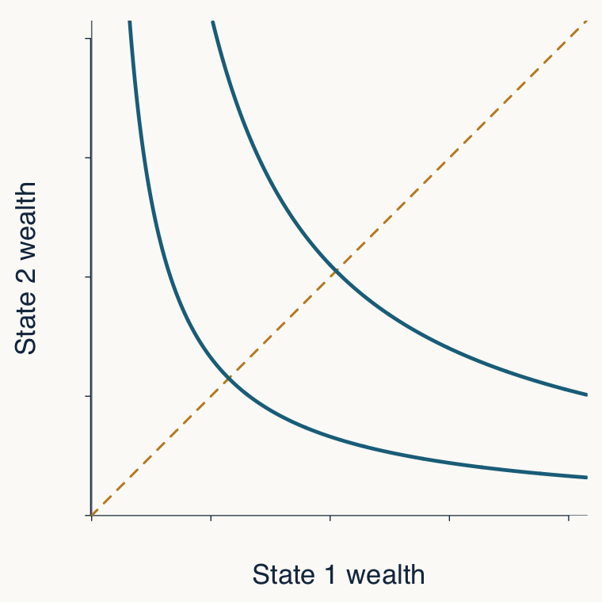
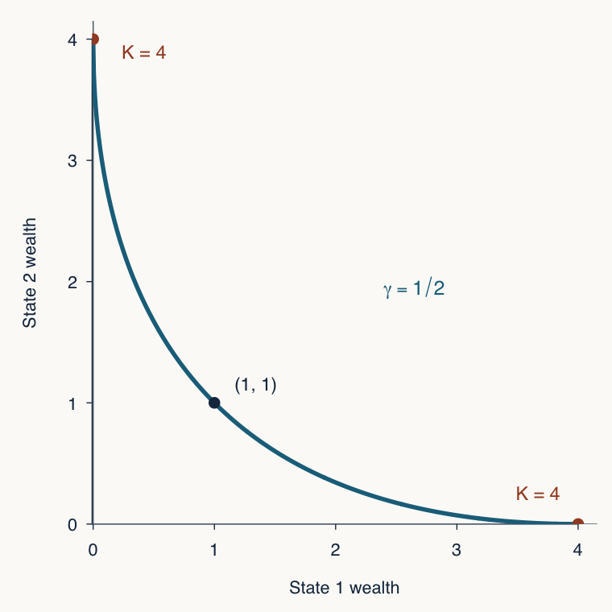
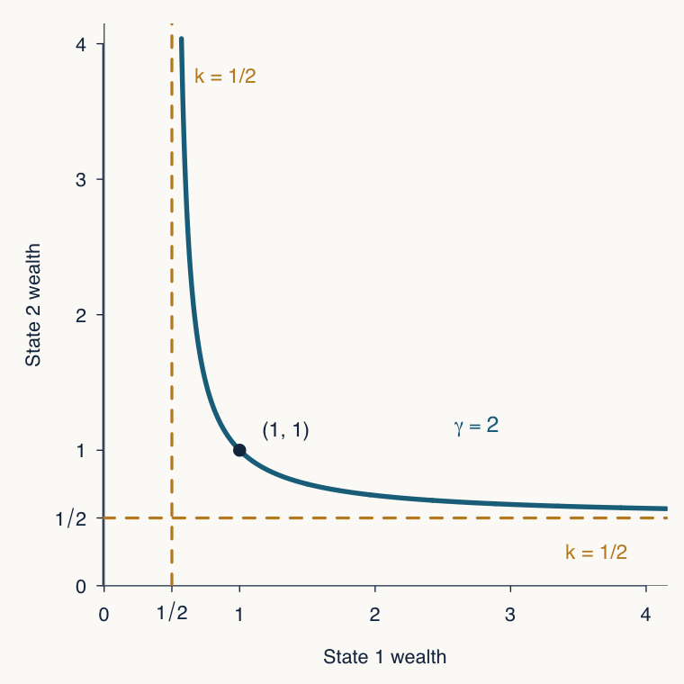
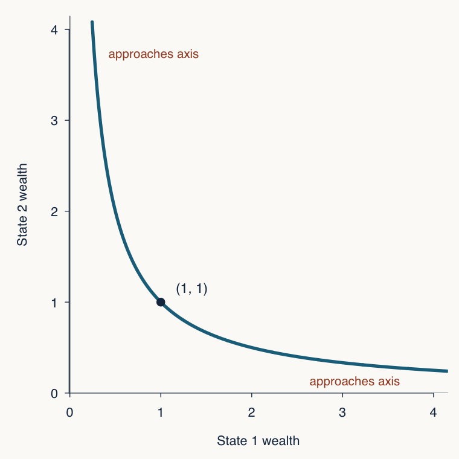
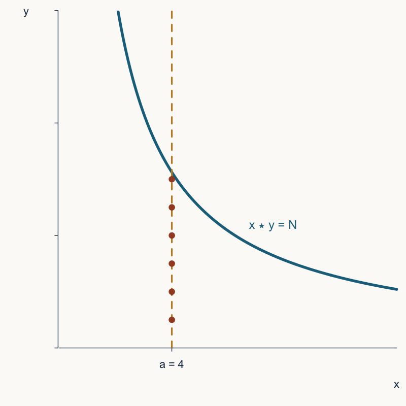

## Understanding multiplication

The usual route defines multiplication from addition by recursion and then derives its properties.

This paper reverses the direction.

::: {.fragment .wash}
Which properties of $\star:\mathbb N^2\to\mathbb N$ leave no possibility except

$$
a\star b=ab?
$$
:::


## Apologies

## `(Preamble)` From an Additive to a Multiplicative HDI

For normalized achievements $h,e,y\in[0,1]$:

::::: {.columns}

:::: {.column width="48%"}
**Additive HDI**

$$
\operatorname{HDI}_A(h,e,y)=\frac{h+e+y}{3}.
$$
::::

:::: {.column width="48%"}
**Multiplicative HDI**

$$
\operatorname{HDI}_M(h,e,y)=(hey)^{1/3}.
$$
::::

:::::

::: {.fragment data-fragment-index="0"}
- **Question:** Which normative properties make an HDI multiplicative?
:::

::::: {.columns .small .tight .fragment data-fragment-index="1"}

:::: {.column width="48%"}
**The additive HDI satisfies**

- Monotonicity
- Symmetry
- Normalization
- Separability
- [Level-independence gains]{.accent}
::::

:::: {.column width="48%"}
**The multiplicative HDI satisfies**

- Monotonicity
- Symmetry
- Normalization
- Separability
- [Minimal lower boundedness]{.accent}
::::

:::::

::: {.aside .fragment data-fragment-index="1"}
Herrero, Martínez, and Villar (2010, pp. 486–487); Zambrano (2014, Theorems 1–2).
:::

## `(Preamble)` Loss limits and the geometry of risk

::: {.fragment data-fragment-index="0"}
CRRA's Bernoulli utility is

$$
u_\gamma(w)=
\begin{cases}
\dfrac{w^{1-\gamma}}{1-\gamma},&\gamma>0,\ \gamma\ne1,\\[0.7em]
\log w,&\gamma=1,
\end{cases}
$$
:::

:::::: {.fragment data-fragment-index="1"}
For a 50--50 gamble, compare state-contingent wealth pairs on the indifference curve through $(w,w)$.

::: {.risk-geometry-plot}
{fig-alt="A generic state-contingent wealth diagram with two indifference curves and the 45-degree line." width="21%"}
:::

::::: {.columns .small}

::: {.column width="32%"}
**Less curvature than log**

$$
0<\gamma<1
$$

:::


::: {.column width="32%"}
**More curvature than log**

$$
\gamma>1
$$

:::

::: {.column width="32%"}
::: {.centered-label}
**Log**
:::

$$
\gamma=1
$$

:::


:::::
::::::

## `(Preamble)` Less curvature than log: a finite all-wealth threshold

::::: {.columns}

::: {.column width="46%"}
For $0<\gamma<1$, the smallest multiple that makes the decision maker willing to risk all initial wealth is

$$
K=2^{\frac1{1-\gamma}},
\qquad
\boxed{\gamma=1-\frac{\log 2}{\log K}}.
$$

For example, $\gamma=\tfrac12$ gives $K=4$.

::: {.formula-box .limit-box}
As $K\to\infty$, $u_\gamma\longrightarrow\log$
:::
:::

::: {.column width="52%"}
{fig-alt="A CRRA indifference curve for gamma equal to one half passing through the normalized point one, one and touching each axis at four." width="100%"}
:::

:::::

## `(Preamble)` More curvature than log: a protected fraction

::::: {.columns}

::: {.column width="46%"}
For $\gamma>1$, the fraction of initial wealth that the decision maker never risks, regardless of the possible gain, is

$$
k=2^{\frac1{1-\gamma}},
\qquad
\boxed{\gamma=1-\frac{\log 2}{\log k}}.
$$

The indifference curve is bounded away from both axes by $kw$. 

For example, $\gamma=2$ gives $k=\tfrac12$.

::: {.formula-box .limit-box}
As $k\to 0$, $u_\gamma\longrightarrow\log$
:::
:::

::: {.column width="52%"}
{fig-alt="A CRRA indifference curve for gamma equal to two passing through one, one and bounded away from both axes by one half." width="100%"}
:::

:::::

## `(Preamble)` Log: the geometric boundary

::::: {.columns}

::: {.column width="46%"}
At $\gamma=1$, the indifference curve approaches each axis but reaches neither one.

::: {.formula-box}
$$
\gamma=1:\qquad K=\infty,\qquad k=0
$$
:::

::: {.fragment .wash}
Log utility separates a finite all-wealth threshold from a positive protected fraction.
:::
:::

::: {.column width="52%"}
{fig-alt="The log-utility indifference curve xy equals one passing through one, one and approaching both axes without touching them." width="100%"}
:::

:::::

## This gave me an idea

::::: {.columns}

::: {.column width="44%"}
- Start with an abstract binary operation $x\star y$

- Fix $x=a$. Count how many $\star-$ multiples $a \star b$ of $a$ are below a threshold $N$.

- Ask which properties of these counts force $\star$ to be ordinary multiplication.

- The count can't be too high, or too low...
:::

::: {.column width="54%"}
{fig-alt="The curve x star y equals N for N equal to 25, with equal scales on both axes, a dashed vertical line at a equal to 4, and six marked star-multiples below the curve." width="100%"}
:::

:::::

## Standing assumptions

The operation satisfies

$$
a\star1=a
\qquad\text{and}\qquad
b<c\;\Longrightarrow\;a\star b<a\star c.
$$

For each fixed $a$, the row

$$
a\star1,\ a\star2,\ a\star3,\ldots
$$

starts at $a$ and increases strictly.

::: aside
Associativity, commutativity, and monotonicity in the first argument do not belong to the standing assumptions.
:::

## Rows and counting functions

For fixed $a$, call the row entries the $\star$-multiples of $a$:

$$
S_a=\{a\star j:j\in\mathbb N\}.
$$

The counting function records how many row entries lie below a threshold:

$$
M_a(N)=\#\{j\in\mathbb N:a\star j\le N\}.
$$

::: {.fragment .key}
The row gives locations. The function $M_a$ gives cumulative counts.
:::

## Counts locate individual row entries

Strict order gives the inverse relation

$$
\boxed{M_a(N)\ge b\quad\Longleftrightarrow\quad a\star b\le N.}
$$

For ordinary multiplication, take $a=4$ and $N=11$:

$$
M_4(11)=2.
$$

Hence

$$
M_4(11)\ge2\Longleftrightarrow 4\cdot2\le11,
\qquad
M_4(11)\not\ge3\Longleftrightarrow4\cdot3\not\le11.
$$

## Ordinary multiplication as a benchmark

For $a\star b=ab$,

$$
S_a=\{a,2a,3a,\ldots\},
\qquad
M_a(N)=\left\lfloor\frac Na\right\rfloor.
$$

The characterization will not assume this formula.

::: {.fragment .wash}
It will assume only two restrictions on what happens when thresholds are added.
:::

## Two pooling principles

:::: {.columns}

::: {.column width="49%"}
### Sufficiency (PS)

$$
\boxed{M_a(N+L)\ge M_a(N)+M_a(L)}
$$

Pooling two sufficient thresholds does not lose row entries.
:::

::: {.column width="49%"}
### Insufficiency (PI)

$$
\begin{aligned}
M_a(N)&<u,\\
M_a(L)&<v
\end{aligned}
\quad\Longrightarrow\quad
\boxed{M_a(N+L)<u+v}
$$

Two deficits cannot disappear together.
:::

::::

::: aside
Every comparison uses the same base $a$.
:::

## Pooling thresholds, not counted sets

**Pooling adds the numerical thresholds $N$ and $L$.** It does not take the union of the sets of row entries counted separately.

For ordinary multiplication, let $a=4$, $N=11$, and $L=10$, so $S_4=\{4,8,12,16,20,\ldots\}$.

:::: {.columns}

::: {.column width="49%"}
### Union of counted sets

$$
\begin{aligned}
S_4\cap[1,11]&=\{4,8\},\\
S_4\cap[1,10]&=\{4,8\}.
\end{aligned}
$$

$$
\{4,8\}\cup\{4,8\}=\{4,8\}.
$$

The union has **two** entries.
:::

::: {.column width="49%"}
### Sum of thresholds

$$
S_4\cap[1,11+10]=\{4,8,12,16,20\}.
$$

The pooled threshold counts **five** entries.
:::

::::

## Main theorem

Let $\star$ satisfy the right identity and strict order in every row.

Suppose $\star$ is either commutative or associative.

Then

$$
\boxed{
\text{(PS) and (PI) hold}
\quad\Longleftrightarrow\quad
a\star b=ab\ \text{for all }a,b.
}
$$

::: {.fragment}
Either commutativity or associativity supplies enough compatibility across rows.
:::

## Ordinary pooling with a carry

Take $a=4$, $N=11$, and $L=10$.

$$
S_4=\{4,8,12,16,20,\ldots\}.
$$

$$
M_4(11)=2,
\qquad
M_4(10)=2,
\qquad
M_4(21)=5.
$$

Therefore

$$
\underbrace{5\ge2+2}_{\text{(PS)}}
\qquad\text{and}\qquad
\underbrace{5<3+3}_{\text{(PI), with }u=v=3}.
$$

::: {.fragment}
The remainders explain the extra count:

$$
11=2\cdot4+3,
\qquad
10=2\cdot4+2,
\qquad
21=5\cdot4+1.
$$
:::

::: aside
**(PS)** $M_a(N+L)\ge M_a(N)+M_a(L)$

**(PI)** $M_a(N)<u,\ M_a(L)<v\ \Longrightarrow\ M_a(N+L)<u+v$.
:::

## The block picture has a limit

For ordinary multiplication, each row has constant spacing $a$, so Euclidean remainders explain the carry.

For a general $\star$, the gaps

$$
(a\star(b+1))-(a\star b)
$$

need not equal $a$, or even remain constant.

::: {.fragment .wash}
The general argument uses the first excluded row entries, not fixed-size blocks.
:::

## Lemma 3.1: the abstract carry

Set

$$
q=M_a(N),
\qquad
r=M_a(L).
$$

(PS) gives the lower bound

$$
M_a(N+L)\ge q+r.
$$

::: {.fragment}
The first excluded counts satisfy

$$
M_a(N)<q+1,
\qquad
M_a(L)<r+1.
$$

(PI) therefore gives

$$
M_a(N+L)<q+r+2.
$$
:::

::: aside
**(PS)** $M_a(N+L)\ge M_a(N)+M_a(L)$

**(PI)** $M_a(N)<u,\ M_a(L)<v\ \Longrightarrow\ M_a(N+L)<u+v$.
:::

## The pooled count has only two possibilities

We have:

$$
M_a(N+L)<q+r+2.
$$
Because the count is integer-valued,

$$
q+r\le M_a(N+L)\le q+r+1.
$$

Equivalently,

::: {.formula-box}
$$
M_a(N+L)
=M_a(N)+M_a(L)+\varepsilon_a(N,L),
\qquad
\varepsilon_a(N,L)\in\{0,1\}.
$$
:::

For example, if $M_a(N)=5$ and $M_a(L)=7$, the pooled count must equal $12$ or $13$.

## Lemma 3.2: threshold duality

The counting principles have equivalent statements about row locations:

$$
\begin{array}{rcll}
\text{(PS)}
&\Longleftrightarrow&
a\star(b+c)\le a\star b+a\star c,
&\text{row subadditivity},\\[0.8em]
\text{(PI)}
&\Longleftrightarrow&
a\star(b+c)\ge a\star b+a\star c-1,
&\text{one-unit superadditivity}.
\end{array}
$$

::: {.fragment .key}
**Counts at pooled thresholds become restrictions on the location of the $(b+c)$-th entry of row $a$.**
:::

## Why (PS) is row subadditivity

::: {.wash .count-location-dictionary}
**Count–location dictionary**

$$
M_a(x)\ge k
\quad\Longleftrightarrow\quad
a\star k\le x.
$$
:::

:::: {.proof-chain}

::: {.proof-step}
$$
N=a\star b,
\qquad
L=a\star c.
$$
:::

::: {.proof-down}
$\Downarrow$
:::

::: {.proof-step}
$$
M_a(N)=b,
\qquad
M_a(L)=c.
$$
:::

::: {.proof-down}
$\Downarrow$
:::

::: {.proof-step .proof-conclusion}
$$
M_a(N+L)\ge b+c
$$

$$
\Longleftrightarrow
\quad
a\star(b+c)\le a\star b+a\star c.
$$
:::

::::

::: aside
**(PS)** $M_a(N+L)\ge M_a(N)+M_a(L)$.
:::

## Why (PI) is one-unit superadditivity

::: {.wash .count-location-dictionary}
**Count–location dictionary**

$$
M_a(x)<k
\quad\Longleftrightarrow\quad
x<a\star k.
$$
:::

:::: {.proof-chain .proof-chain-compact}

::: {.proof-step}
$$
N=a\star b-1,
\qquad
L=a\star c-1.
$$
:::

::: {.proof-down}
$\Downarrow$
:::

::: {.proof-step}
$$
M_a(N)<b,
\qquad
M_a(L)<c.
$$
:::

::: {.proof-down}
$\Downarrow$
:::

::: {.proof-step}
$$
M_a(N+L)<b+c
\quad\Longleftrightarrow\quad
N+L<a\star(b+c).
$$
:::

::: {.proof-down}
$\Downarrow$
:::

::: {.proof-step .proof-conclusion}
$$
a\star b+a\star c-2<a\star(b+c)
$$

$$
\Longleftrightarrow
\quad
a\star(b+c)\ge a\star b+a\star c-1.
$$
:::

::::

::: aside
**(PI)** $M_a(N)<u,\ M_a(L)<v\ \Longrightarrow\ M_a(N+L)<u+v$.
:::

## Because ordinary multiplication is distributive, it satisfies threshold duality

Take $a=4$, $b=2$, and $c=3$.

:::: {.columns}

::: {.column width="49%"}
**PS**

$$
a\star(b+c)\le a\star b+a\star c.
$$

$$
4(2+3)\le4\cdot2+4\cdot3,
\qquad
20\le20.
$$
:::

::: {.column width="49%"}
**PI**

$$
a\star(b+c)\ge a\star b+a\star c-1.
$$

$$
4(2+3)\ge4\cdot2+4\cdot3-1,
\qquad
20\ge19.
$$
:::

::::


## A one-unit distributive defect

Recall Lemma 3.2:

$$
\begin{aligned}
\text{(PS)}&\Longleftrightarrow a\star(b+c)\le a\star b+a\star c
&&\text{row subadditivity},\\
\text{(PI)}&\Longleftrightarrow a\star(b+c)\ge a\star b+a\star c-1
&&\text{one-unit superadditivity}.
\end{aligned}
$$

Together they give

$$
\boxed{
0\le
a\star b+a\star c-a\star(b+c)
\le1.
}
$$

Pooling permits a one-unit failure of distributivity; commutativity or associativity eliminates it.

::: aside
**(PS)** $M_a(N+L)\ge M_a(N)+M_a(L)$

**(PI)** $M_a(N)<u,\ M_a(L)<v\ \Longrightarrow\ M_a(N+L)<u+v$.
:::

## Remark 3.3: each row is almost linear

For fixed $a$, write $g(b)=a\star b$. Then

$$
g(b+c)\le g(b)+g(c),
\qquad
g(b+c)-1\ge(g(b)-1)+(g(c)-1).
$$

Fekete's lemma gives a slope $\theta_a$ such that

$$
\boxed{
\theta_a b\le a\star b\le\theta_a b+1,
\qquad
a-1\le\theta_a\le a.
}
$$

::: {.fragment .wash}
Pooling determines the shape of a row, but not yet its slope.
:::

## Example

For $a\ge2$, define

$$
a\diamond b
=
\left\lceil\left(a-\frac12\right)b\right\rceil.
$$

For $a=4$, this becomes

$$
4\diamond b=\left\lceil3.5b\right\rceil.
$$

## Ordinary multiplication vs $4\diamond b=\left\lceil3.5b\right\rceil$

| $b$ | 1 | 2 | 3 | 4 | 5 | 6 |
|---:|---:|---:|---:|---:|---:|---:|
| $4b$ | 4 | 8 | 12 | 16 | 20 | 24 |
| $4\diamond b$ | 4 | 7 | 11 | 14 | 18 | 21 |

Both rows lie within one unit of a line:

$$
\theta_4=4
\qquad\text{or}\qquad
\theta_4=3.5.
$$


::: {.fragment}
The second row satisfies the pooling restrictions but is not the ordinary multiplication row.
:::

## Main theorem

Let $\star$ satisfy the right identity and strict order in every row.

Suppose $\star$ is either commutative or associative.

Then

$$
\boxed{
\text{(PS) and (PI) hold}
\quad\Longleftrightarrow\quad
a\star b=ab\ \text{for all }a,b.
}
$$

::: {.fragment}
Either commutativity or associativity supplies enough compatibility across rows.
:::

## Proof architecture

**1. Pooling bounds every individual product**

::: {.formula-box}
$$
(a-1)b+1\le a\star b\le ab.
$$
:::

**2. Row subadditivity scales any shortfall**

$$
a\star b=ab-d,
\qquad
d\ge1.
$$

$$
\Longrightarrow
$$

::: {.formula-box}
$$
a\star(kb)\le k(a\star b)
$$
:::

$$
k(a\star b)=k(ab-d)=a(kb)-kd.
$$

**3. Commutativity or associativity moves the replicated shortfall across rows**

**4. Unless** $a\star b=ab$**, the amplified lower and upper bounds cross.**

## Lemma 4.1: initial bounds

Recall

$$
\begin{aligned}
\text{(PS)}&\Longleftrightarrow a\star(b+c)\le a\star b+a\star c,\\
\text{(PI)}&\Longleftrightarrow a\star(b+c)\ge a\star b+a\star c-1.
\end{aligned}
$$

::: {.fragment}
Then

$$
a\star b+a\star c-1
\le a\star(b+c)
\le a\star b+a\star c.
$$
:::

::: {.fragment}
Set $g(b)=a\star b$. Since $g(1)=a$, this gives

$$
g(b)+a-1\le g(b+1)\le g(b)+a.
$$
:::

::::: {.iteration-steps}
::: {.fragment}
Iterating from $g(1)=a$:

$$
a+(a-1)\le g(2)\le a+a.
$$
:::

::: {.fragment .formula-box}
$$
(a-1)2+1\le g(2)\le 2a.
$$
:::

::: {.fragment}
$$
g(2)+(a-1)\le g(3)\le g(2)+a.
$$
:::

::: {.fragment}
$$
(a-1)2+1+(a-1)\le g(3)\le 2a+a.
$$
:::

:::: {.fragment}
::: {.formula-box}
$$
(a-1)3+1\le g(3)\le 3a.
$$
:::

$$
\vdots
$$
::::
:::::

::: {.fragment}
::: {.formula-box}
$$
(a-1)b+1\le a\star b\le ab.
$$
:::
:::

<!-- ::: {.fragment}
For $a=4$, each step in the row adds either $3$ or $4$, or lies between those values when viewed through the inequalities.
::: -->

## The initial band for $a=4$

| $b$ | Lower bound $3b+1$ | $4\diamond b=\left\lceil3.5b\right\rceil$ | Ordinary value $4b$ |
|---:|---:|---:|---:|
| 1 | 4 | 4 | 4 |
| 2 | 7 | 7 | 8 |
| 3 | 10 | 11 | 12 |
| 4 | 13 | 14 | 16 |
| 5 | 16 | 18 | 20 |

::: {.key}
Pooling confines the row to a widening band. It does not yet select the upper boundary.
:::

::: {.formula-box .formula-box-corner}
$$
(a-1)b+1\le a\star b\le ab.
$$
:::

## Lemma 4.1: replication

Recall

$$
\text{(PS)}\Longleftrightarrow a\star(b+c)\le a\star b+a\star c.
$$

::: {.fragment}
Set $g(t)=a\star t$. Then

$$
g(x+y)\le g(x)+g(y).
$$
:::

::: {.fragment}
Iterating with blocks of size $b$:

$$
\begin{gathered}
g(2b)\le g(b)+g(b)=2g(b),\\
g(3b)\le g(2b)+g(b)\le 3g(b),\\
\vdots
\end{gathered}
$$
:::

::: {.fragment}
::: {.formula-box}
$$
a\star(kb)\le k(a\star b).
$$
:::
:::

## Lemma 4.1: shortfall scaling

Repeated row subadditivity is equivalent to a lower bound on the replicated shortfall:

$$
a\star(kb)\le k(a\star b)
\quad\Longleftrightarrow\quad
a(kb)-a\star(kb)
\ge k\bigl(ab-a\star b\bigr).
$$

Take $a=4$, $b=3$, and $k=4$, and write $d=ab-a\star b$.

| Row | At $b=3$ | Replication | Shortfall at $kb=12$ |
|:---|:---:|:---:|:---:|
| Ordinary $ab$ | $4\cdot3=12$, $d=0$ | $4\cdot12=48=4(4\cdot3)$ | $48-48=0=4d$ |
| $a\diamond b=\left\lceil\left(a-\frac12\right)b\right\rceil$ | $4\diamond3=11$, $d=1$ | $4\diamond12=42\le4(4\diamond3)=44$ | $48-42=6\ge4d=4$ |

::: {.fragment .wash}
For multiplication, replication is exact and the shortfall remains zero. For $\diamond$, a one-unit shortfall becomes at least four units; here it becomes six.
:::

::: {.formula-box .formula-box-corner}
$$
a\star(kb)\le k(a\star b).
$$
:::

## Rigidity under commutativity

Fix $a,b$, set $r=a\star b$, and suppose

$$
r\le ab-1.
$$

Commutativity turns the initial lower bound around:

$$
a\star t=t\star a\ge a(t-1)+1.
$$

At $t=ab$,

$$
a(ab-1)+1\le a\star(ab).
$$

Replication with $k=a$ gives

$$
a\star(ab)\le ar\le a(ab-1),
$$

a contradiction.

::: {.formula-box .formula-box-corner}
$$
\begin{gathered}
(a-1)b+1\le a\star b\le ab,\\
a\star(kb)\le k(a\star b).
\end{gathered}
$$
:::

## Rigidity under commutativity

::::: {.columns .small}

:::: {.column width="55%"}
Fix $a,b$, set $r=a\star b$, and suppose

$$
r\le ab-1.
$$

Commutativity turns the initial lower bound around:

$$
a\star t=t\star a\ge a(t-1)+1.
$$

At $t=ab$,

$$
a(ab-1)+1\le a\star(ab).
$$

Replication with $k=a$ gives

$$
a\star(ab)\le ar\le a(ab-1),
$$

a contradiction.

::: {.formula-box}
$$
\begin{gathered}
(a-1)b+1\le a\star b\le ab,\\
a\star(kb)\le k(a\star b).
\end{gathered}
$$
:::
::::

:::: {.column width="42%"}
::: {.wash}
**The case $a=4$, $b=3$**

Suppose $4\star3\le11$. Replication gives

$$
4\star12\le4(4\star3)\le44.
$$

Commutativity and the initial lower bound give

$$
\begin{aligned}
4\star12&=12\star4\\
&\ge(12-1)4+1=45.
\end{aligned}
$$

The permitted bounds do not meet.
:::
::::

:::::

## Rigidity under associativity {#rigidity-under-associativity}

Again suppose $r=a\star b\le ab-1$. For every $n$,

$$
\begin{aligned}
nr
&\ge n\star r
&&\text{initial upper bound}\\
&=(n\star a)\star b
&&\text{associativity, }r=a\star b\\
&\ge(n\star a-1)b+1
&&\text{initial lower bound}\\
&\ge((n-1)a)b+1
&&\text{since }n\star a\ge(n-1)a+1\\
&=(n-1)ab+1.
\end{aligned}
$$

Set $n=ab$. The assumed shortfall also gives

$$
nr\le n(ab-1)=(n-1)ab,
$$

again a contradiction by one unit.

::: aside
[example](#associativity-numerical-example)
:::

::: {.formula-box .formula-box-corner}
$$
\begin{gathered}
(a-1)b+1\le a\star b\le ab,\\
a\star(kb)\le k(a\star b).
\end{gathered}
$$
:::

## Finite amplification

::: {.wash}
One product that is one unit too small creates a replicated discrepancy. Row compatibility makes that discrepancy conflict with a lower bound elsewhere.
:::

The argument converts

$$
a\star b<ab
$$

into two incompatible integer bounds on one larger product.

<!-- ## Structural consequences

For an ordered monoid $(\mathbb N,\star,1)$, the pooling principles imply ordinary multiplication.

Therefore the operation is commutative and factorial, and

$$
M_a(N)=\left\lfloor\frac Na\right\rfloor.
$$

The number of ordered two-factor decompositions becomes

$$
\#\{(a,b)\in\mathbb N^2:a\star b=n\}=d(n).
$$

::: aside
The divisor count follows after recovering multiplication. The pooling principles do not directly estimate $d(n)$.
:::

-->
## Proposition 4.3: pooling across factor roles

Assume a two-sided identity and strict increase in both arguments.

Use

$$
M_a(N)=\#\{j:a\star j\le N\}
$$

for rows, and

$$
\widetilde M_b(N)=\#\{i:i\star b\le N\}
$$

for columns.

Then row-(PS) together with column-(PI) already forces

$$
\boxed{a\star b=ab.}
$$

No associativity or commutativity is assumed.

## The role of the mixed proposition {#the-role-of-the-mixed-proposition}

:::: {.columns}

::: {.column width="49%"}
Row-(PS) supplies

$$
a\star(b+c)
\le a\star b+a\star c.
$$

This gives upper bounds and replication.
:::

::: {.column width="49%"}
Column-(PI) supplies

$$
(a+b)\star c
\ge a\star c+b\star c-1.
$$

This gives the transverse lower bound.
:::

::::

::: {.fragment .wash}
Commutativity is one way to transport information between factor positions. Mixed pooling imposes the needed transport directly.
:::

::: aside
[proof](#the-mixed-proof-in-one-calculation)
:::

## A failure diagnosed by column pooling

Consider

$$
1\diamond b=b,
\qquad
a\diamond b=\left\lceil\left(a-\tfrac12\right)b\right\rceil
\quad(a\ge2).
$$

Every row satisfies both original pooling principles, but the $b=4$ column begins

$$
4,\ 6,\ 10,\ldots
$$

Hence

$$
\widetilde M_4(3)=0<1,
\qquad
\widetilde M_4(6)=2\not<2.
$$

Column-(PI) fails when two thresholds of $3$ are pooled.

## Independence of the pooling principles

:::: {.columns}

::: {.column width="49%"}
### (PS) without (PI)

$$
a\star_+b=a+b-1
$$

At $a=3$,

$$
M_3(3)=1<2,
\qquad
M_3(6)=4\not<4.
$$

Pooling removes one copy of the row's initial offset.
:::

::: {.column width="49%"}
### (PI) without (PS)

$$
a\star_{\mathrm o}b=2ab-a-b+1
$$

At $a=2$,

$$
M_2(2)=1,
\qquad
M_2(4)=1<2.
$$

Pooling two sufficient thresholds still reaches only one row entry.
:::

::::

::: aside
**(PS)** $M_a(N+L)\ge M_a(N)+M_a(L)$

**(PI)** $M_a(N)<u,\ M_a(L)<v\ \Longrightarrow\ M_a(N+L)<u+v$.
:::

## Pooling without row compatibility

For the operation $\diamond$,

$$
M_1(N)=N,
\qquad
M_a(N)=\left\lfloor\frac{N}{a-1/2}\right\rfloor
\quad(a\ge2).
$$

Both pooling principles hold in every row. Nevertheless,

$$
2\diamond4=6\ne7=4\diamond2
$$

and

$$
(2\diamond2)\diamond4=10
\ne
9=2\diamond(2\diamond4).
$$

The operation is neither commutative nor associative.

<!-- ## The structural assumptions have separate jobs

| Assumption | Its role |
|---|---|
| Right identity | Anchors the first entry of row $a$ at label $a$ |
| Strict row order | Lets counts locate individual row entries |
| (PS) | Supplies subadditivity and replication |
| (PI) | Limits the pooled count to one extra entry |
| Commutativity or associativity | Couples otherwise independent rows | -->

<!-- ## The argument in one line

$$
\boxed{\begin{gathered}
\text{pooling}
\Longrightarrow
\text{one-unit row defect}
\Longrightarrow
\text{almost-linear rows}\\[0.35em]
\Longrightarrow
\text{finite amplification}
\Longrightarrow
\text{multiplication}
\end{gathered}}
$$

The first two implications concern one row at a time.

The last two require compatibility across rows. -->

## Context and contribution

The paper gives a paired counting characterization under either compatibility law, with direct finite proofs, a mixed row-column variant, and independence examples.

The counting axioms yield row inequalities and numerical bounds. From these, [Fekete's lemma (1923)](https://doi.org/10.1007/BF01504345) and [Székelyhidi's superstability theorem (1982)](https://doi.org/10.1090/S0002-9939-1982-0633285-6) give alternative completions of the commutative and associative arguments, respectively.

<!-- ## Formal verification

::::: {.columns}

:::: {.column width="48%"}

The characterization, threshold equivalences, rigidity arguments, and counterexamples have been verified in Lean 4 using Mathlib.

The development includes:

- the commutative and associative versions of the main theorem
- the mixed row-column proposition
- the independence examples and structural counterexamples

::: {.small .muted}
The formalization is sorry-free and pinned to Lean 4.24.0 and a fixed Mathlib commit.
:::

::::

:::: {.column width="50%" .lean-excerpt}

**From pooling to rigidity in Lean**

```lean
  · rintro ⟨hps, hpi⟩
    have hsub := (ps_iff_rowSub hpos hstrict).mp hps
    have hsuper := (pi_iff_rowSuper hpos hstrict).mp hpi
    rcases hcompat with hcomm | hassoc
    · exact rigidity_of_comm hunit hsub hsuper hcomm
    · exact rigidity_of_assoc hpos hunit hsub hsuper hassoc
```

::: {.small}
[Source: `PoolingMultiplication/Main.lean`, lines 24–29](https://github.com/eduardo-zambrano/pooling-multiplication-lean/blob/f991f441e24e897c58588d2d8f02938505047afd/PoolingMultiplication/Main.lean#L24-L29)
:::

::::

::::: -->

## Formal verification

::::: {.columns}

:::: {.column width="48%"}

The characterization, threshold equivalences, rigidity arguments, and counterexamples have been verified in Lean 4 using Mathlib.

The development includes:

- the commutative and associative versions of the main theorem
- the mixed row-column proposition
- the independence examples and structural counterexamples

::: {.small .muted}
The formalization is sorry-free and pinned to Lean 4.24.0 and a fixed Mathlib commit.
:::

::::

:::: {.column width="50%"}

<iframe src="https://github.com/eduardo-zambrano/pooling-multiplication-lean" title="Snapshot of the pooling multiplication Lean repository" width="100%" height="550" loading="eager" style="border: 1px solid #b8c7cc; background: white;"></iframe>

::: {.small}
[Open the live repository in a separate tab](https://github.com/eduardo-zambrano/pooling-multiplication-lean)
:::

::::

:::::

## `(Side note)` Multiplication up to isomorphism {#side-note-multiplication-up-to-isomorphism}

In Zambrano (2026), a reduced commutative monoid $M$ satisfies four axioms:

::::: {.columns}

:::: {.column width="49%"}
**(WFD) Well-founded divisibility**

**(TD) Tower disjointness**
::::

:::: {.column width="49%"}
**(CFI) Coprime factorization independence**

**(CCA) Coprime coverage of the atoms**
::::

:::::

$$
\text{(WFD), (TD), (CFI), (CCA)}
\quad\Longleftrightarrow\quad
M\cong(\mathbb N,\times).
$$

::: {.fragment .wash}
These axioms determine the abstract monoid. They leave the numerical labels of its products undetermined.
:::

::: aside
[$\cong \ne =$](#side-note-abstract-algebra-leaves-the-numerical-table-free)
:::

## Conclusion: Counts as an identification device

::: {.wash}
Under strict row order, counts and locations are inverse descriptions:

$$
\boxed{M_a(N)\ge b\quad\Longleftrightarrow\quad a\star b\le N.}
$$

The family $\{M_a\}_{a\in\mathbb N}$ therefore encodes the entire operation.
:::

## Conclusion: What the counting argument delivers

The benchmark $M_a(N)=\lfloor N/a\rfloor$ is never assumed.

$$
\text{(PS) and (PI)}
\quad\Longleftrightarrow\quad
0\le a\star b+a\star c-a\star(b+c)\le1.
$$

- **Threshold duality** turns the two pooling principles into a one-unit row defect.
- **Finite amplification** makes any shortfall replicate.
- **Compatibility across rows** makes the replicated shortfall impossible.

::: {.wash}
$$
\boxed{a\star b=ab}
$$

The exact numerical table is recovered, not only its abstract isomorphism type.
:::

<!-- ## Open questions

::::: {.columns}

:::: {.column width="49%"}
**Larger defects**

$$
0\le
a\star b+a\star c-a\star(b+c)
\le C.
$$

Which operations arise under the same compatibility laws?
::::

:::: {.column width="49%"}
**Factor counts**

$$
F_{2,\star}(n)
:=
\#\{(a,b)\in\mathbb N^2:a\star b=n\}.
$$

Can benchmark-free principles for these nonmonotone counts identify multiplication?
::::

::::: -->

# Thank you!!

# Appendix

## Multiplication up to isomorphism (Zambrano, 2026)

Let $(M,\cdot,1)$ be a reduced commutative monoid with atom set $P$. Powers and divisibility are taken in $M$. Set $\mathcal F_2(z)=\{(u,v)\in M^2:u\cdot v=z\}$.

::::: {.columns .small}

:::: {.column width="49%"}
**(WFD) Well-founded divisibility**  
The relation $x\prec y\iff y=x\cdot z$ for some $z\ne1$ is well-founded.

**(TD) Tower disjointness**  
$p^k=q^m\Longrightarrow p=q$ for $p,q\in P$ and $k,m\ge1$.
::::

:::: {.column width="49%"}
**(CFI) Coprime factorization independence**  
If no atom divides both $x$ and $y$, the following map is bijective:

$$
\begin{aligned}
\mu_2:\mathcal F_2(x)\times\mathcal F_2(y)&\longrightarrow\mathcal F_2(x\cdot y),\\
((x_1,x_2),(y_1,y_2))&\longmapsto(x_1\cdot y_1,x_2\cdot y_2)
\end{aligned}
$$

**(CCA) Coprime coverage of the atoms**  
There are pairwise coprime $m_i\ne1$ ($i\ge1$) such that $\forall p\in P,\ \exists i\ge1:\ p\mid m_i$.
::::

:::::

$$
\text{(WFD), (TD), (CFI), (CCA)}
\quad\Longleftrightarrow\quad
(M,\cdot)\cong(\mathbb N,\times).
$$

::: {.fragment .wash}
These axioms determine the abstract monoid. They leave the numerical labels of its products undetermined.
:::


## `(Side note)` Abstract algebra leaves the numerical table free {#side-note-abstract-algebra-leaves-the-numerical-table-free}

Let $\nu:\mathbb N\to\mathbb N$ be a bijection with $\nu(1)=1$. Transport ordinary multiplication by defining

$$
a\star b=\nu^{-1}\!\bigl(\nu(a)\nu(b)\bigr).
$$

::: {.fragment data-fragment-index="0"}
For example, let $\nu$ swap $2$ and $3$ and fix every other integer. Then

$$
2\star2=9,
\qquad
3\star3=4.
$$
:::

::: {.fragment data-fragment-index="1"}
The $2$-row begins

$$
2\star1,\;2\star2,\;2\star3,\;2\star4,\ldots
=2,\;9,\;6,\;12,\ldots
$$

so it immediately violates strict row order.
:::

::: {.fragment .wash data-fragment-index="2"}
Yet $\star$ remains isomorphic to ordinary multiplication.

The $\star$-atoms are still exactly the ordinary primes. Even the number of ordered two-factor decompositions of each $n$ is unchanged.
:::

::: {.small}
Return to [multiplication up to isomorphism](#side-note-multiplication-up-to-isomorphism).
:::


## The mixed proof in one calculation {#the-mixed-proof-in-one-calculation}

Row-(PS) gives

$$
a\star(kb)\le k(a\star b).
$$

Column-(PI) and the two-sided identity give

$$
a\star t\ge a(t-1)+1.
$$

If $a\star b\le ab-1$, take $k=a$ and $t=ab$:

$$
a(ab-1)+1
\le a\star(ab)
\le a(a\star b)
\le a(ab-1),
$$

a contradiction.

::: {.small}
Return to [the role of the mixed proposition](#the-role-of-the-mixed-proposition).
:::

## Associativity: the case $4\star3=11$ {#associativity-numerical-example}

Suppose, for contradiction, that an admissible associative operation had $4\star3=11$. Set $n=4\cdot3=12$.

The initial lower bound gives

$$
12\star4\ge(12-1)4+1=45.
$$

Associativity and another application of that bound give

$$
\begin{aligned}
12\star11
&=12\star(4\star3)=(12\star4)\star3\\
&\ge(12\star4-1)3+1
\ge(45-1)3+1=133.
\end{aligned}
$$

But the initial upper bound gives $12\star11\le12\cdot11=132$. Thus $133\le12\star11\le132$, a contradiction.

::: {.small}
Return to [rigidity under associativity](#rigidity-under-associativity).
:::
